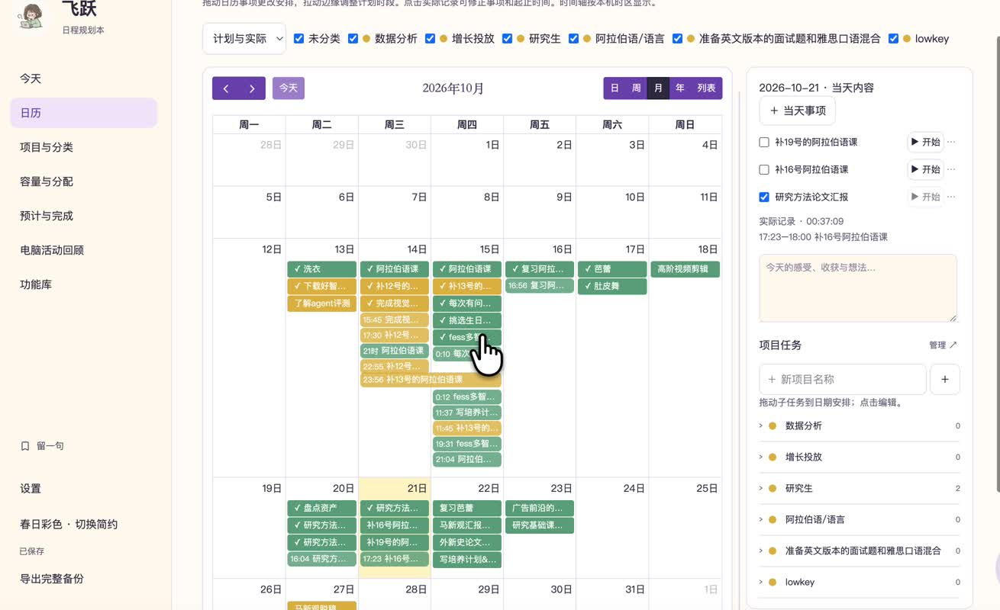

<div align="center">


# 飞跃日程规划本

**把一年放在眼前，把今天一件件完成。**

从纸本的年、月、周，到桌面上的一张小清单。<br>
安排日程、管理项目、记录真实投入，也给随想留一点空白。

[](https://github.com/SasaFreya/feiyue-planner/releases/tag/v0.3.1)


**[访问介绍与下载页 →](https://sasafreya.github.io/feiyue-planner/)** · **[直接下载 Mac 安装包 ↓](https://github.com/SasaFreya/feiyue-planner/releases/download/v0.3.1/Feiyue-Planner-0.3.1-macOS-arm64.zip)** · [版本说明](https://github.com/SasaFreya/feiyue-planner/releases/tag/v0.3.1)

<br>

<a href="https://sasafreya.github.io/feiyue-planner/#film"></a>

<sub>真实使用录屏已裁去桌面文件和背景；软件内的日程内容经作者允许展示。<a href="https://sasafreya.github.io/feiyue-planner/#film">观看演示</a>。</sub>

</div>

## 从想做，到安排，再到完成

飞跃最初来自一本用顺手的纸质日程本。纸本能让人同时看见一个月、一周和一天，电子工具则更适合移动事项、重复安排、自动保存与统计。飞跃把这两种体验放在一起。

你可以先把事情放进自由栏或未安排清单，再分到某一天；执行时打开桌面小清单，完成一项就勾掉一项。如果想知道时间实际花在哪里，可以开始计时，回到日历和时间记录里查看。

| 你想做什么 | 在飞跃里怎么做 |
| --- | --- |
| 看清这一年和这个月 | 全年日历、年度纵览、月度事项与日 / 周 / 月 / 年日历 |
| 给这一周留出位置 | 七天纸本式周计划、每日待办、时间轴、随记和周自由栏 |
| 先记住，之后再安排 | 自由收集、未安排事项、项目任务池；拖动或点选分配 |
| 专注今天的几件事 | 今日清单、手动排序、完成进度与桌面悬浮入口 |
| 分清计划和真实投入 | 预计分钟、计划时段与实际计时分开记录 |
| 回顾和保留自己的记录 | 时间统计、随笔、句子收藏、回响之书与导出 |

## 下载并开始使用

### Mac · Apple Silicon

**[下载飞跃日程规划本 0.3.1（ZIP，约 111 MB）](https://github.com/SasaFreya/feiyue-planner/releases/download/v0.3.1/Feiyue-Planner-0.3.1-macOS-arm64.zip)**

适用于 M 系列芯片的 Mac。安装包已经包含运行环境，不需要自行安装 Node.js 或启动开发服务器。

1. 下载并解压 ZIP。
2. 将 **飞跃日程规划本.app** 拖到“应用程序”。
3. 打开应用，从“今天”写下第一件事；点击桌面头像可展开或收起小清单。
4. 按需要在“功能库”中固定常用入口，切换春日彩色或简约主题。

当前程序使用本机临时签名，**尚未经过 Apple 公证**。macOS 可能提示无法验证开发者；请先确认下载来自本仓库，再按系统“隐私与安全性”中的提示处理。如果系统提示软件损坏、存在恶意内容或显示其他异常，请先到 [Issues](https://github.com/SasaFreya/feiyue-planner/issues) 描述情况，不建议执行来历不明的绕过命令。

| 发行平台 | 当前状态 |
| --- | --- |
| macOS · Apple Silicon（M 系列） | 已提供 0.3.1 ZIP |
| macOS · Intel | 尚未提供安装包 |
| Windows / Linux | 尚未提供安装包 |
| 自动更新 | 尚未实现，更新时请下载新版本 |

<details>
<summary>下载校验值</summary>

SHA-256：

```text
b4bfea43a7b64d6094a8ea72f562e1b1fa164d55fce972111d1bee567be05f30
```

在 macOS 终端进入下载目录后运行：

```bash
shasum -a 256 Feiyue-Planner-0.3.1-macOS-arm64.zip
```

</details>

## 纸本的全局视野

- **全年日历**：十二个月一起看，点击日期进入相应规划，有记录的日期显示标记。
- **年度纵览**：十二个月 × 31 日的重要记录，禁用不存在的日期。
- **月度事项**：按季度组织，每月六项可以勾选的事项与小日历。
- **周计划**：一周七列、每天五项待办、5–24 点时间轴和每日随记。
- **周自由栏**：先收集待分配事项，支持增加行数；另有自由书写区。
- **移动和撤销**：在事项、时间格和自由栏间拖动；已有内容的落点可交换，支持撤销并保护后续编辑。

原来的纸本结构保留在“笔记与心愿”等相关入口。常用功能可以固定在侧栏，其他功能收进“功能库”；隐藏入口不会删除已有记录。

## 桌面上的一张小清单

点击悬浮头像展开今日事项，写下、排序、勾选或开始计时；外圈显示当天完成比例，可在设置中关闭。打开完整窗口后，可以继续看日历、项目和时间记录。

**完整窗口、小清单和本机浏览器使用同一份本机数据。** 应用运行时，从菜单栏打开 `http://127.0.0.1:17863` 就能在浏览器查看。关闭主窗口不等于退出应用；菜单栏提供退出入口。

## 项目、日历和真实用时

| 模块 | 可以做什么 |
| --- | --- |
| 项目与分类 | 自定义名称与纯色，管理任务、归档分类，保留历史记录 |
| 日历与安排 | 切换日 / 周 / 月 / 年 / 列表；拖动事项调整日期和时段，点击日期查看当天内容 |
| 项目管理 | 任务池、截止日期、每日容量与安全线；按需分配未安排事项 |
| 专注执行 | 正计时与倒计时；同一时间只运行一个计时器 |
| 时间记录 | 按日 / 周 / 月 / 年或自选范围回看；按事项与项目汇总，补录与修正时段 |
| 预计与完成 | 按预计分钟查看完成趋势，与实际计时统计分开 |
| 重复安排 | 使用 rrule 生成固定练习、课程或周期回顾，先预览再加入日历 |
| 电脑活动回顾 | 桌面端可选开启应用活动记录，排除闲置；与手动事项计时分开 |

计时采用真实开始 / 暂停片段，不把事项的预计时长当成已经投入的时间。外部 ActivityWatch、solidtime 等接入仍有未完成真实服务联调的部分，详见 [开源接入与验收](docs/开源接入实现与验收-2026-10-16.md)。

## 留下记录，也保管好记录

随记、周随笔、月度心愿和句子收藏，可以与任务一起保留。回响之书按周翻阅；不同模块提供 CSV、ICS、JSON、打印 / PDF 等导出入口，具体范围见页面中的导出选项。

- 桌面主数据库：`~/Library/Application Support/FeiyuePlanner/planner.sqlite`。
- 应用提供完整 JSON 导出，以及本机每日快照和最近更新快照。**目前没有可视化完整恢复 / 导入流程。**
- 升级优先使用已有本机库；0.3.1 发行包固定使用空种子，不包含作者的日程、SQLite 数据库或备份。
- 备份数据库前建议正常退出应用，并保留相关 WAL / SHM 文件；不要只拷贝运行中的主 SQLite 文件。
- 数据目前没有应用级加密。开启外部连接器、导入或导出时，请留意你选择的服务和文件位置。

### 关于网页和跨设备

这个仓库的 **GitHub Pages 是公开介绍与下载页**，不会在页面里存放你的日程。作者另有仅本人可访问的私人线上实例，普通访客不能把它当成公共试用服务。

桌面 SQLite 和私人线上 D1 **目前独立**，不会自动上传、合并或双向同步。私人站点已发布，但登录后的生产读写和双设备同步尚未完成验收。不能把“网页能打开”理解为“桌面数据已经云同步”。

## 常见问题

<details>
<summary><b>第一次使用需要账号或联网吗？</b></summary>

桌面核心规划与计时可以在本机使用，不需要登录飞跃账号。下载安装包需要联网；外部连接器按其服务要求使用网络。

</details>

<details>
<summary><b>换电脑或升级会丢数据吗？</b></summary>

新包优先读取同一数据目录中的已有库，不会用空种子覆盖。更新前仍建议导出并保留备份。跨电脑自动同步、完整可视化恢复尚未交付，迁移前请先备份，不要直接删除旧库。

</details>

<details>
<summary><b>手机、Windows 和 Intel Mac 可以用吗？</b></summary>

当前公开安装包面向 Apple Silicon Mac。网页代码包含响应式布局，但没有面向所有人的云服务；其他桌面平台也尚无已验证的发行包。

</details>

<details>
<summary><b>如何反馈问题？</b></summary>

可以在本仓库 [提交 Issue](https://github.com/SasaFreya/feiyue-planner/issues)，附版本、系统和复现步骤。应用内反馈先保存在本机，不会自动发送给作者。上传截图或录屏前请隐藏真实任务、文件名、账号和活动记录。

</details>

## 从源码运行

建议使用 **Node.js 22.13+** 和 npm；桌面原生助手构建需要 macOS 与 Xcode Command Line Tools。当前打包脚本以 Apple Silicon 为目标。

```bash
git clone https://github.com/SasaFreya/feiyue-planner.git
cd feiyue-planner
npm ci
npm run desktop:dev
```

桌面启动会构建 UI 和本机服务，并打开 Electron 应用。仅编辑界面时，可以在应用运行后使用：

```bash
npm run desktop:preview
```

浏览器访问终端给出的 `http://127.0.0.1:17865`；该开发界面默认依赖桌面应用提供本机 API。网页开发入口 `npm run dev` 也使用现有本机共享服务，不是一个独立云服务。

| 命令 | 用途 |
| --- | --- |
| `npm run test:planner` | 共享事项、排序、计时、迁移与 API 回归测试 |
| `npx tsc --noEmit` | TypeScript 检查 |
| `npm run build` | Vinext / Cloudflare Worker 网页生产构建 |
| `npm run desktop:build` | 桌面 UI、主进程和空数据种子 |
| `npm run desktop:package` | 打包 Apple Silicon Mac 应用 |

### 代码结构

```text
app/             网页入口与 D1 API
features/        规划、日历、计时与扩展业务模块
components/      复用界面组件
desktop-shell/  Electron 主进程、悬浮清单、本机 API 与 SQLite
db/ + drizzle/  云端数据库模型与迁移
site/           GitHub Pages 介绍与下载页
docs/           设计记录、功能进展与验收边界
```

生产部署继续使用 `.openai/hosting.json` 中注册的既有 Sites 项目；检查纯结构迁移、测试和构建，使用私人发布流程。不要把本机数据库、安装备份、环境变量或私人种子上传到仓库和部署包。

## 当前进展

- **0.3.1 · 2026-10-20**：公开源码与 Apple Silicon Mac ZIP；发行构建使用空种子，保留已有用户库。26 项回归测试、TypeScript 和生产构建通过；发行包空种子与签名完整性已检查。
- **2026-10-21**：完善项目介绍与 GitHub Pages 下载页。真实录屏裁去桌面与背景，经作者允许保留软件内记录。
- **仍待完成**：Apple 公证、其他平台安装包、自动更新、可视化完整恢复，以及桌面与云端的跨设备同步验收。

每次设计决定和实际状态持续记录在 [产品设计想法](docs/产品设计想法.md)，讨论中的想法与已交付功能分别标记。

## 致谢与许可说明

飞跃使用 React、Electron、SQLite、FullCalendar、dnd-kit、rrule、shadcn/ui 等项目；接入与授权出处见 [依赖声明](public/open-source-integrations-NOTICES.txt) 和源码内对应的许可文件。项目介绍的组织方式参考了 [TextFold](https://github.com/chenxiachan/textfold)，文案与界面为飞跃重新编写。

**当前仓库公开源码，但尚未指定项目整体的开源许可证。** 查看源码不等于获得任意再分发许可；第三方组件仍遵循各自许可证。

---

<div align="center">

如果飞跃对你有帮助，欢迎 [Star 项目](https://github.com/SasaFreya/feiyue-planner) 或分享你的使用反馈。<br>
由 [SasaFreya](https://github.com/SasaFreya) 制作。

</div>
